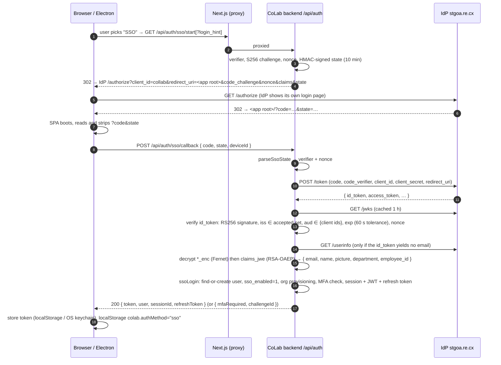
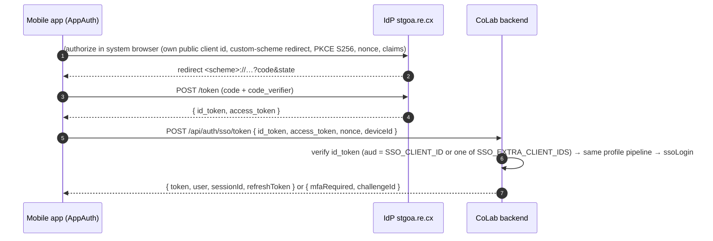
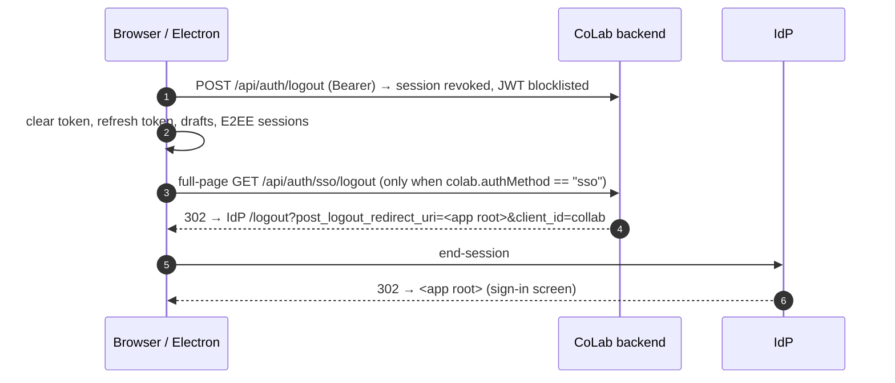

# CoLab — SSO Integration Guide (OpenID Connect, Authorization Code + PKCE)

| | |
|---|---|
| **Scope** | How Single Sign-On is implemented in the CoLab monorepo, how to configure it per environment, how web / desktop / mobile clients use it, how to operate and troubleshoot it. |
| **Audience** | Backend, frontend, mobile and DevOps engineers on CoLab; the AgenXchange SSO/IdP team (sections 4, 6 and 11). |
| **Source of truth** | Derived from the code on branch `run` as of 2026-10-08: `backend/app/src/services/ssoService.ts`, `backend/app/src/services/authService.ts`, `backend/app/src/routes/auth.ts`, `config/src/index.ts`, `frontend/app/src/components/LoginScreen.tsx`, `frontend/app/src/components/colab/session/useCoLab0.tsx` / `useCoLab1.tsx`, `desktop/main.js`, `desktop/config.js`, `database/migrations/0073_sso_enabled.sql` / `0074_sso_backfill.sql`, `backend/app/test/sso.test.ts`. |
| **Related docs** | `docs/SSO.md` (backend notes), `docs/SSO_MOBILE.md` (Flutter guide), `sso-Integration-guidev3.html` (client-facing walkthrough aligned with AgenXchange guide v3), `docs/ENV_VIA_AZURE.md` (secret handling for live). |
| **Secrets** | This document never contains secret values. Variable *names* and host names are listed; values live in the per-environment `.env.*` files and the Azure `colab-live-env` variable group. |

---

## 1. Summary

CoLab authenticates users against the shared **AgenXchange Identity Provider (IdP)** using **OpenID Connect, Authorization Code flow with PKCE (S256)**. CoLab is registered on the IdP as a **confidential client** (`client_id = collab`, server-side client secret) and PKCE is still enforced on every request. The IdP never releases a password to CoLab; after the user signs in on the IdP, CoLab's backend exchanges the authorization code server-to-server, validates the signed `id_token`, decrypts the encrypted profile claims, finds or creates a local account, and mints CoLab's own session (JWT + rotating refresh token). From that point every CoLab API call is authenticated by CoLab's JWT, exactly as for password logins.

Key properties of the implementation:

- **One IdP, three environments.** The IdP host is `https://stgoa.re.cx/` (also reachable as `https://oa.re.cx/`, same issuer). Each environment registers its own `redirect_uri` (the app root), which is also the `post_logout_redirect_uri`.
- **One env var drives the endpoints.** `SSO_BASE_URL` derives `/authorize`, `/token`, `/jwks`, `/userinfo`, `/logout`; explicit `SSO_*_URL` vars override; OIDC discovery fills gaps.
- **No PII in the clear.** The IdP ships profile data as `claims_jwe` (RSA-OAEP JWE encrypted to CoLab's public key) and/or Fernet `*_enc` fields. CoLab decrypts server-side; decrypted values win over plaintext.
- **Stateless across backend instances.** The OAuth `state` is HMAC-signed and carries the PKCE verifier and nonce (10-minute TTL), so no server-side storage is needed between the redirect and the callback.
- **Three client shapes share the same backend.** Web (SPA) and Electron desktop use the redirect flow via `/api/auth/sso/start` + `/api/auth/sso/callback`. Mobile apps run PKCE natively and post the IdP tokens to `/api/auth/sso/token`.
- **App session semantics are unchanged.** SSO sessions get the same durable session row, 7-day JWT, 30-day rotating refresh token, device binding, session limits and app-level MFA step-up as password logins.

---

## 2. Architecture

### 2.1 Components

| Layer | File | Responsibility |
|---|---|---|
| Config | `config/src/index.ts` (`sso` block, lines ~83–143) | Reads every `SSO_*` variable once; frozen config object consumed by the backend. |
| Protocol service | `backend/app/src/services/ssoService.ts` (735 lines) | PKCE helpers, HMAC-signed state, endpoint resolution and discovery (1 h cache), authorize/logout URL building, back-channel token exchange, `id_token` verification (JWKS, 1 h cache, one forced refetch on key rotation), `claims_jwe` decryption (jose), Fernet `*_enc` decryption (Node crypto), `/userinfo` fallback, profile extraction. |
| Account service | `backend/app/src/services/authService.ts` → `ssoLogin()` (lines ~625–705) | Find-or-create passwordless account, stamp `users.sso_enabled`, optional org auto-provisioning (`ORG_BOOTSTRAP_OWNERS`, `SSO_GROUP_ROLE_MAP`), MFA step-up, session + JWT + refresh token minting, device binding. |
| HTTP routes | `backend/app/src/routes/auth.ts` (lines ~218–327) | `GET /sso/status`, `GET /sso/start`, `GET /sso/logout`, `POST /sso/callback`, `POST /sso/token`. |
| Rate limits | `backend/app/src/app.ts` (lines ~70–105) | `/sso/callback` 20 per 15 min per IP; `/sso/token` 30 per 15 min per IP (shared `authLimiter`). In-memory per process. |
| Web client | `frontend/app/src/components/LoginScreen.tsx` | "Email / SSO" method selector; choosing SSO performs a full-page navigation to `/api/auth/sso/start`. |
| Web client | `frontend/app/src/components/colab/session/useCoLab1.tsx` (lines ~868–959) | Boot-time handling of `?code&state` (one-shot exchange), `?error` / `?sso_error`, and the IdP launcher `?login_hint`. |
| Web client | `frontend/app/src/components/colab/session/useCoLab0.tsx` (`doLogout`, lines ~1079–1130) | After local logout, SSO sessions are sent through `/api/auth/sso/logout` to end the IdP session. |
| Web client | `frontend/app/src/lib/api.ts` (lines ~331–351) | `ssoStartUrl(loginHint?)`, `ssoLogoutUrl()`, `ssoCallback(code, state)` (adds the E2EE `deviceId`), `ssoStatus()`. |
| Web client | `frontend/app/src/lib/config.ts` | `ssoEnabled = NEXT_PUBLIC_SSO_ENABLED !== "0"` (build-time flag that shows the SSO option). |
| Desktop | `desktop/config.js`, `desktop/main.js` (lines ~1496–1575) | `authOrigins` allow-list so the IdP pages load in-window; "← Back to sign in" button injected on IdP pages. |
| Database | `database/migrations/0073_sso_enabled.sql`, `0074_sso_backfill.sql`; `database/src/drivers/mysql.ts` (`users.setSsoEnabled`, members query ~line 7129) | `users.sso_enabled` flag; passwordless ⇔ SSO-only derivation for the admin console. |
| Keys | `scripts/gen-sso-keys.sh`, `keys/README.md` | RSA-2048 pair for `claims_jwe`; `keys/*.pem` is git-ignored. |
| Tests | `backend/app/test/sso.test.ts` (13 cases) | PKCE, signed state, `ssoConfigured`, JWE decrypt (right key / wrong key / tamper / no key), Fernet decrypt vs Python reference, `*_enc` resolution, token-login input validation. |

### 2.2 Sign-in sequence (web and desktop)



### 2.3 Native / mobile sequence



### 2.4 Logout sequence



---

## 3. Protocol details as implemented

### 3.1 Authorize request (`buildLoginRedirect`)

Parameters sent to the IdP `/authorize` endpoint:

| Parameter | Value |
|---|---|
| `response_type` | `code` |
| `client_id` | `SSO_CLIENT_ID` |
| `redirect_uri` | `SSO_REDIRECT_URI` (must match the IdP registration byte-for-byte) |
| `scope` | `SSO_SCOPE`, default `openid profile email` |
| `state` | HMAC-SHA256-signed base64url JSON `{ v: verifier, n: nonce, e: expiry }` |
| `nonce` | random, 16 bytes base64url |
| `code_challenge` / `code_challenge_method` | `S256(verifier)` / `S256` |
| `claims` | JSON requesting `email, email_verified, name, picture, department, employee_id, claims_jwe, products, entitlements` in both `id_token` and `userinfo` (all optional per OIDC Core §5.5) |
| `login_hint` | forwarded only if the SPA passed a syntactically valid e-mail (`cleanLoginHint`) |

If `SSO_IDP_URL` is set, the browser is sent to `<SSO_IDP_URL>/login?return_to=<authorize URL>`; otherwise straight to `/authorize`. The staging IdP shows its own login page either way, so `SSO_IDP_URL` is normally blank.

### 3.2 State handling (`createSsoState` / `parseSsoState`)

- Signed with `SSO_STATE_SECRET` → falls back to `AUTH_SSO_SECRET` → falls back to `AUTH_JWT_SECRET`.
- TTL 10 minutes; constant-time signature comparison; rejects forged, malformed or expired state with HTTP 400 `SSO_STATE_MISMATCH` ("Your sign-in link expired").
- Because each environment signs with its own secret, a code returned to the wrong host is always rejected.

### 3.3 Endpoint resolution (`resolveEndpoints`)

Order for each endpoint: explicit `SSO_*_URL` → derived from `SSO_BASE_URL` (`/authorize`, `/token`, `/jwks`, `/logout`) → OIDC discovery (`<base>/.well-known/openid-configuration`, cached 1 h, best-effort) → derived from the authorize URL origin. Discovery is skipped entirely when `SSO_AUTHORIZE_URL`, `SSO_TOKEN_URL`, `SSO_JWKS_URL` and `SSO_ISSUER` are all set. Note that this IdP publishes its key set at `/jwks`, not `/.well-known/jwks.json`.

### 3.4 `id_token` verification (`verifyIdToken`)

| Check | Rule |
|---|---|
| Signature | RS256 (algorithm taken from the token header, default RS256) against the JWK whose `kid` matches; JWKS cached 1 h; on "no matching key / invalid signature" the JWKS is refetched once (key rotation). |
| `aud` | Must equal `SSO_CLIENT_ID` or one of `SSO_EXTRA_CLIENT_IDS` (mobile client ids). Never an arbitrary audience. |
| `iss` | Must be one of the **accepted issuer set**: `SSO_ISSUER`, the discovery document's `issuer` (only when discovery ran), and the origins of `SSO_BASE_URL`, `SSO_AUTHORIZE_URL`, `SSO_IDP_URL`, `SSO_TOKEN_URL` (trailing slashes normalised). On mismatch the error names both the stamped and the accepted values. |
| `exp` | 60 s clock tolerance. |
| `nonce` | Must equal the nonce carried in the state (web) or posted by the app (mobile, optional). |
| Dev escape hatch | `SSO_INSECURE_SKIP_VERIFY=true` decodes without signature verification **only** outside production and only when the JWKS fetch failed; production refuses with HTTP 500. |

### 3.5 Profile resolution (`resolveSsoProfile`)

1. Claims from the signature-verified `id_token`.
2. Decrypt any Fernet `*_enc` fields (`email_enc`, `name_enc`, `picture_enc`, `department_enc`, `employee_id_enc`) with `SSO_PROFILE_ENC_SECRET` (key = base64url(SHA256(secret)); AES-128-CBC + HMAC-SHA256, verified against Python `cryptography.Fernet` in tests). Blank secret → `*_enc` ignored; wrong secret → HTTP 401.
3. Decrypt `claims_jwe` with the RSA private key (`SSO_JWE_PRIVATE_KEY_FILE` or inline `SSO_JWE_PRIVATE_KEY`, raw PEM or base64, PKCS#1 or PKCS#8). Accepted key-wrap algorithms: `RSA-OAEP`, `RSA-OAEP-256/384/512` (`RSA1_5` refused). **Fails closed**: a `claims_jwe` that cannot be opened rejects the sign-in; it never falls back to plaintext.
4. If no usable e-mail resulted and an `access_token` exists, fetch `/userinfo`, merge it underneath the id_token claims and run steps 2–3 again.
5. Decrypted values always override plaintext. E-mail is lower-cased and must match a basic e-mail regex; `preferred_username` is accepted as a fallback.

Outputs: `{ email, name, groups, picture, department, employeeId }`. `name` falls back to `given_name` then the local part of the e-mail. `groups` comes from `groups` / `roles` / `role` claims when the IdP sends them. `picture` must be an `http(s)` URL.

A login with no e-mail fails with HTTP 400 listing the claim keys received and a hint (no `claims_jwe` → public key probably not registered on the IdP; `*_enc` present but no `SSO_PROFILE_ENC_SECRET`; no profile claims at all → client scope/profile settings).

### 3.6 Account provisioning (`ssoLogin`)

| Step | Behaviour |
|---|---|
| Lookup | By normalised e-mail. |
| New user | Created **passwordless** (`password_hash` NULL): id derived from e-mail, name/initials/colour derived, `avatarUrl` seeded from the IdP `picture`, platform role `member`, presence `online`. Such accounts can only sign in via SSO (or after an admin password reset). |
| Existing user | Reused as-is; profile and password are never overwritten. |
| `sso_enabled` | Stamped to 1 on first SSO login (migration 0073). Migration 0074 back-filled passwordless accounts. The admin console derives "SSO" as `sso_enabled OR no password` and offers password reset only where a local password exists (`OrgAdmin.tsx`, `OrgMembersTab.tsx`). |
| Organisation | A new SSO user lands **org-less** and goes through Create/Join onboarding. Auto-provisioning happens only on an explicit signal: e-mail listed in `ORG_BOOTSTRAP_OWNERS` → owner of the default org (elevate-only), or an IdP group mapped by `SSO_GROUP_ROLE_MAP` (`IdpGroupA:admin,IdpGroupB:member`; highest rank wins; ranks owner 100 > admin 80 > member 40 > guest 20). The default org is `SSO_DEFAULT_ORG_SLUG` or the sole org on a single-tenant deployment. Best-effort; never blocks sign-in and never demotes. |
| MFA | If `MFA_ENABLED` and the user has TOTP enrolled, the response is `{ mfaRequired: true, challengeId, methods: ["totp"] }` and the client must call `POST /api/auth/mfa/verify`. A lookup error fails closed (503). |
| Session | `createSession` (device/UA/geo, `jti`), `issueRefreshToken` (30-day rotating), `tokenFor(user, deviceId, jti)` (7-day HS256 JWT; `deviceId` is honoured only if the device exists, belongs to the user and is not revoked). |
| Audit | `audit_log` action `auth.sso`; `announceLogin` notifies the user's other sessions. |

---

## 4. Registration on the IdP (what the SSO team holds)

| Item | Value / action |
|---|---|
| Client id | `collab` (confidential client; client secret used on `/token`; PKCE S256 always on) |
| Scope | `openid profile email` |
| `redirect_uri` per environment | local `http://localhost:3002` · UAT `https://collab-uat.resulticks.com` · production `https://collab.resulticks.com` — the **app root, no trailing slash**, byte-for-byte. An unregistered `redirect_uri` is answered with HTTP 400 by the IdP before its login page, which looks like "SSO does nothing". |
| `post_logout_redirect_uri` | The same app root per environment. |
| Homepage / launcher URL | The app root; the IdP may open it with `?login_hint=<email>`. |
| `claims_jwe` public key | `keys/agenxchange_public.pem` (RSA-2048, `BEGIN PUBLIC KEY`) handed to the SSO team; one pair per environment recommended. Status on 2026-09-16: staging already decrypts with the key generated for the UAT/local work, i.e. that public key is registered for client `collab`. **Do not regenerate the pair** once the IdP holds the public key. |
| Mobile client | A separate **public** client (token auth `none`) with a custom-scheme redirect such as `com.resulticks.collab://sso/callback`; its client id goes into `SSO_EXTRA_CLIENT_IDS` on the backend. |
| Profile claims | The IdP must release the profile pack (`email`, `name`, `picture`, `department`, `employee_id`, `claims_jwe`) for client `collab`; otherwise sign-in fails with "no usable email claim". |
| Issuer | Discovery on both `stgoa.re.cx` and `oa.re.cx` publishes `issuer = https://stgoa.re.cx`; the `id_token` `iss` is `https://stgoa.re.cx`. |

---

## 5. Configuration reference

All backend variables are read in `config/src/index.ts`; `SSO_GROUP_ROLE_MAP`, `SSO_DEFAULT_ORG_SLUG` and `ORG_BOOTSTRAP_OWNERS` are read directly from `process.env` in `authService.ts` / `drivers/mysql.ts`.

| Variable | Required | Purpose |
|---|---|---|
| `SSO_ENABLED` | yes | Master switch (default false). `ssoConfigured()` also requires client id, redirect URI and an authorize URL or issuer. |
| `SSO_BASE_URL` | yes | IdP host, e.g. `https://stgoa.re.cx/`. Derives `/authorize`, `/token`, `/jwks`, `/logout`; also the discovery base. |
| `SSO_CLIENT_ID` | yes | `collab`. |
| `SSO_CLIENT_SECRET` | yes for the confidential client | Sent on `/token`; server-side only. Blank = public client (staging rejects with `invalid_client`). |
| `SSO_REDIRECT_URI` | yes | Exact registered app root for this environment. Also used as the app root for post-logout return. |
| `SSO_JWE_PRIVATE_KEY_FILE` or `SSO_JWE_PRIVATE_KEY` | yes once the IdP sends `claims_jwe` | RSA private key; file path (Docker: `/app/keys/collab_private.pem`, `./keys` is mounted read-only at `/app/keys` in `docker-compose.yml` and `docker-compose.live.yml`) or inline PEM / base64 (Azure variable group, marked secret). |
| `SSO_PROFILE_ENC_SECRET` | when the IdP sends `*_enc` fields | Fernet shared secret from the SSO team; server-side only. |
| `SSO_STATE_SECRET` | recommended | HMAC key for the signed state. Falls back to `AUTH_SSO_SECRET`, then `AUTH_JWT_SECRET`. |
| `SSO_ISSUER` | recommended | Expected `iss` (`https://stgoa.re.cx`). Setting it to the wrong host (e.g. `oa.re.cx`) breaks every login with "issuer mismatch"; this happened twice on 2026-09-17 when `.env.live` was produced by find-and-replace from `.env.teams`. |
| `SSO_EXTRA_CLIENT_IDS` | for mobile | Comma-separated additional `aud` values accepted by `/sso/token`. |
| `SSO_SCOPE` | no | Default `openid profile email`. |
| `SSO_IDP_URL` | no | Separate login host that wraps the authorize URL in `return_to`. Leave blank for this IdP. |
| `SSO_AUTHORIZE_URL`, `SSO_TOKEN_URL`, `SSO_JWKS_URL`, `SSO_USERINFO_URL`, `SSO_LOGOUT_URL` | no | Explicit overrides; when authorize+token+jwks+issuer are all set, discovery is skipped. |
| `SSO_INSECURE_SKIP_VERIFY` | never in production | Dev-only unverified decode when JWKS is unreachable. |
| `SSO_GROUP_ROLE_MAP` | no | `IdpGroup:role,…` mapping for org auto-provisioning. |
| `SSO_DEFAULT_ORG_SLUG` | no | Target org for auto-provisioning on multi-org deployments. |
| `ORG_BOOTSTRAP_OWNERS` | recommended for first admin | Comma-separated e-mails elevated to owner of the default org on every sign-in. Solves the "first SSO admin" chicken-and-egg. |
| `NEXT_PUBLIC_SSO_ENABLED` | frontend, build-time | Shows the SSO option unless set to `"0"`. Baked into the frontend Docker image. |
| `MFA_ENABLED` | no | Enables app-level TOTP step-up, which also applies to SSO logins. |

Desktop (`desktop/config.js` / `collab.config.json` / env): `COLLAB_AUTH_ORIGINS` or `authOrigins` lists the IdP origins allowed to load in-window. Defaults in all environments: `https://stgoa.re.cx`, `https://oa.re.cx`, `http://10.200.1.58:7505`.

### 5.1 Per-environment matrix

| Environment | Env file | App root = `SSO_REDIRECT_URI` | Notes |
|---|---|---|---|
| local | `.env` | `http://localhost:3002` | Registered on the IdP. Backend must reach `stgoa.re.cx`; otherwise hide SSO with `NEXT_PUBLIC_SSO_ENABLED=0`. Private key: `keys/collab_private.pem`. |
| teams / UAT | `.env.teams` | `https://collab-uat.resulticks.com` | Redirect URI registration was still an open action for the SSO team in guide v3. |
| run / production | `.env.live` (rendered from Azure `colab-live-env`) | `https://collab.resulticks.com` | Registered. `.env.live.template` expects `SSO_BASE_URL`, `SSO_JWE_PRIVATE_KEY`, `SSO_JWE_PRIVATE_KEY_FILE`; `scripts/render-env-live.ps1` and `docs/ENV_VIA_AZURE.md` list `SSO_CLIENT_SECRET` and `SSO_JWE_PRIVATE_KEY` as secret variables. Per the 2026-09 notes `.env.live` still pointed some URLs at `oa.re.cx`; both hosts front the same IdP, but `SSO_ISSUER` must be `https://stgoa.re.cx`. |

---

## 6. Key material and secrets handling

1. **Generate once per environment**: `scripts/gen-sso-keys.sh [out-dir]` → `keys/collab_private.pem` (chmod 600) and `keys/agenxchange_public.pem`. The script refuses to overwrite an existing private key.
2. **Share** only `agenxchange_public.pem` with the AgenXchange team (out of band).
3. **Deploy** the private key either by copying it to `<deploy dir>/keys/collab_private.pem` (mounted read-only into the backend container) or by pasting `base64 -i keys/collab_private.pem | tr -d '\n'` into `SSO_JWE_PRIVATE_KEY` in the Azure variable group. Leave the other variable blank.
4. **Never commit** `keys/*.pem`; `.gitignore` covers `keys/*.pem`, `keys/*.json`, `keys/*.p8`.
5. **Rotation**: generating a new pair requires re-registering the public key on the IdP; until then every `claims_jwe` fails to decrypt and SSO sign-in is blocked (fail-closed).

> **Repository hygiene finding (2026-10-08).** `git ls-files` shows `keys/AuthKey_37PG75SL4U.p8` (APNs) and `keys/GoogleService-Info.plist` are tracked despite the ignore rules, and `cookies.txt` is tracked at the repo root. These are not SSO files, but they share the `keys/` directory. Rotate them and purge history before the next hand-over. The SSO `.pem` files themselves are not tracked.

---

## 7. Client integration

### 7.1 Web (Next.js SPA)

| Step | Code |
|---|---|
| Show the option | `LoginScreen.tsx` renders the "Email / SSO" selector when `config.ssoEnabled` and not in sign-up mode. Picking "SSO" calls `window.location.assign(api.ssoStartUrl())` after a 130 ms repaint delay. |
| Return from the IdP | The IdP redirects to the app root with `?code&state`. `useCoLab1.tsx` captures them in `ssoBoot` at first render, strips `code, state, error, sso_error, session_state, iss, login_hint` from the URL via `history.replaceState`, and calls `api.ssoCallback(code, state)` exactly once (`ssoExchangedRef` guards React StrictMode double effects; the code is single-use). |
| Success | `authSuccess(token, user, refreshToken)`; `localStorage.colab.authMethod = "sso"`; `tokenStore.saveToken` (localStorage on web, OS keychain on desktop) and `initE2EE`. |
| Errors | `?error=access_denied` → "SSO sign-in was cancelled"; `?sso_error=not_configured` → "SSO isn't configured on this server yet"; `start_failed` → "Couldn't start SSO sign-in"; callback failures show the backend's diagnostic message (`SSO_FAILED`). |
| IdP launcher | `?login_hint=<email>` with no code: if no saved token exists, the SPA immediately navigates to `/api/auth/sso/start?login_hint=…`; with a saved session it just restores it. |
| Logout | `doLogout` → `POST /api/auth/logout` → clear local state → if `colab.authMethod === "sso"`, `window.location.assign(api.ssoLogoutUrl())`. |
| Device binding | `api.ssoCallback` posts the E2EE `deviceId` (`localStorage.e2ee_device_id`) so the session token is device-bound like password logins. |

### 7.2 Desktop (Electron)

The desktop app loads the hosted web app, so the web flow applies unchanged. Desktop-specific behaviour in `desktop/main.js`:

- `will-navigate` allows top-frame navigation only to the app origin or an `authOrigins` entry; everything else opens in the system browser. Without this the IdP redirect was kicked out of the window and the flow restarted.
- `setWindowOpenHandler` allows popups to `authOrigins` (some IdP/MFA flows open a popup).
- A "← Back to sign in" button is injected on IdP pages via `executeJavaScript` (positioned to avoid the macOS traffic lights) because the window has no browser chrome.
- The IdP origin must therefore be in `authOrigins` for every environment the build targets; override with `COLLAB_AUTH_ORIGINS` or `collab.config.json` without rebuilding.
- Tokens are stored through `window.collabDesktop.secureStore` (Electron `safeStorage`).

### 7.3 Mobile / native (Flutter or any AppAuth client)

Documented in detail in `docs/SSO_MOBILE.md`. Essentials:

1. Register a public mobile client on the IdP with a custom-scheme redirect; get its client id added to `SSO_EXTRA_CLIENT_IDS`.
2. Run Authorization Code + PKCE in the system browser with the same `claims` JSON and a random `nonce`.
3. Exchange the code at the IdP `/token` with the `code_verifier`.
4. `POST /api/auth/sso/token { id_token, access_token, nonce, deviceId }` → `{ token, user, sessionId, refreshToken }` or `{ mfaRequired, challengeId, methods }`.
5. Use `Authorization: Bearer <token>`; refresh with `POST /api/auth/refresh { refreshToken, deviceId }`; sign out with `POST /api/auth/logout` and then the IdP `/logout` in the system browser.

---

## 8. API reference

All responses use the envelope `{ ok: true, data }` or `{ ok: false, error: { code, message } }`.

| Endpoint | Auth | Request | Response | Errors |
|---|---|---|---|---|
| `GET /api/auth/sso/status` | none | — | `{ enabled, configured }` | — |
| `GET /api/auth/sso/start[?login_hint=<email>]` | none | — | `302` to the IdP authorize URL | `302 /?sso_error=not_configured`, `302 /?sso_error=start_failed` |
| `POST /api/auth/sso/callback` | none; 20 req / 15 min / IP | `{ code, state, deviceId? }` | `{ token, user, sessionId, refreshToken }` or `{ mfaRequired, challengeId, methods }` | `400 SSO_BAD_CALLBACK`, `400 SSO_STATE_MISMATCH`, `400/401/502 SSO_FAILED` with the diagnostic message (token exchange status, JWKS fetch, issuer/audience/nonce mismatch, JWE/Fernet failure, no e-mail claim) |
| `POST /api/auth/sso/token` | none; 30 req / 15 min / IP | `{ id_token, access_token?, nonce?, deviceId? }` | same as callback | `400` missing/malformed id_token, `401` verification failures, `429`, `502` IdP unreachable |
| `GET /api/auth/sso/logout` | none | — | `302` to IdP end-session with `post_logout_redirect_uri=<app root>&client_id=…`, or to the app root if no end-session URL is known | — |
| `POST /api/auth/logout` | Bearer | — | revokes session, blocklists JWT | — |
| `POST /api/auth/refresh` | none | `{ refreshToken, deviceId }` | `{ token, refreshToken, user }` | `409` concurrent rotation, `401` replay/revoked |
| `POST /api/auth/mfa/verify` | none | `{ challengeId, code }` | `{ token, user, sessionId, refreshToken }` | `401` |

Server log lines are prefixed `[sso]` and report each step (`1/4 exchanging code`, `2/4 token response`, `3/4 verifying id_token`, claim keys received, `/userinfo` fetched, `*_enc` decrypted, `claims_jwe` decrypted, `4/4 find-or-create`). With `API_DEBUG_LOG=true` every request/response is logged with secrets redacted and correlated by the `X-Request-Id` header.

---

## 9. Security posture

| Control | Status |
|---|---|
| PKCE S256 on every sign-in, even with a client secret | Implemented |
| Anti-CSRF `state`, HMAC-signed, 10-minute TTL, constant-time compare | Implemented |
| Nonce bound to the login | Implemented (web always; mobile when supplied) |
| `id_token` signature via JWKS, `aud`, `iss` set, `exp` | Implemented, fail-closed in production |
| PII decrypted only from a verified `id_token` or `/userinfo` fetched with the fresh access token; RSA1_5 rejected | Implemented |
| App JWT never in a URL (returned in the POST body) | Implemented |
| Brute-force limits on callback and token endpoints | Implemented (in-memory per process; a multi-replica deployment needs a shared store) |
| Audit record `auth.sso` | Implemented |
| Passwordless SSO accounts; existing accounts never clobbered | Implemented |
| RP-initiated logout ending the IdP session | Implemented (web/desktop automatic; mobile documented) |

Known gaps and risks (verified in code):

1. **MFA step-up is not handled by the web client.** `ssoLogin` (and password `login`) can return `{ mfaRequired, challengeId }`, but `useCoLab1.tsx` passes the SSO response straight to `authSuccess(token, user, refreshToken)` and there is no `mfaRequired` handling anywhere in `frontend/app/src`. With `MFA_ENABLED=true` an enrolled user cannot complete sign-in on the web. Only the mobile guide covers the MFA branch.
2. **State secret defaults to the app JWT secret.** Acceptable, but set `SSO_STATE_SECRET` explicitly so a JWT-secret rotation does not invalidate in-flight logins and the two keys are independent.
3. **Issuer configuration is fragile.** A wrong `SSO_ISSUER` fails every login. The accepted-issuer set mitigates when discovery runs, but discovery is skipped when all four explicit URLs are set. Prefer `SSO_BASE_URL` + `SSO_ISSUER=https://stgoa.re.cx` and leave the explicit URLs blank.
4. **Desktop default `authOrigins` includes a plaintext HTTP IdP origin** (`http://10.200.1.58:7505`) in all environments, which also receives in-window navigation and camera/microphone permission grants (`mediaPermissions.js`). Remove it from the production default.
5. **Rate limiters are per process** (`middleware/rateLimit.ts`), so limits scale with the number of backend replicas.
6. **Dev escape hatch** `SSO_INSECURE_SKIP_VERIFY` must stay unset outside local development; production refuses it, but staging/UAT would honour it.
7. **Fail-open elsewhere in auth** (session lookup errors in `middleware/auth.ts`) applies equally to SSO sessions after sign-in; see the architecture report (`arch.html` §7).
8. **Secrets under `keys/` tracked in git** (APNs key, Firebase plist) — not SSO, but the same directory; rotate and purge.

---

## 10. Deployment checklist

### 10.1 New environment

- [ ] Ask the SSO team to register the environment's app root as `redirect_uri` and `post_logout_redirect_uri` for client `collab`, and to enable the profile claims for it.
- [ ] Generate the RSA pair with `scripts/gen-sso-keys.sh`; hand over `agenxchange_public.pem`; place `collab_private.pem` on the server (`<deploy dir>/keys/`) or inline in the secret store.
- [ ] Set `SSO_ENABLED=true`, `SSO_BASE_URL`, `SSO_CLIENT_ID`, `SSO_CLIENT_SECRET`, `SSO_REDIRECT_URI`, `SSO_ISSUER=https://stgoa.re.cx`, `SSO_STATE_SECRET`, `SSO_JWE_PRIVATE_KEY[_FILE]`, `SSO_PROFILE_ENC_SECRET` (if the IdP uses `*_enc`), `NEXT_PUBLIC_SSO_ENABLED=true`.
- [ ] Seed the first administrator with `ORG_BOOTSTRAP_OWNERS=<email>` (SSO users otherwise land org-less).
- [ ] For mobile, add the mobile client id to `SSO_EXTRA_CLIENT_IDS`.
- [ ] Rebuild the frontend image if `NEXT_PUBLIC_SSO_ENABLED` changed (it is baked at build time); restart the backend for `SSO_*` changes.
- [ ] Desktop: ensure the IdP origin is in `authOrigins` (default already includes `stgoa.re.cx` and `oa.re.cx`).

### 10.2 Live (Azure-rendered `.env.live`)

- [ ] In the `colab-live-env` variable group set `SSO_BASE_URL`, `SSO_ISSUER`, `SSO_CLIENT_SECRET` (secret), `SSO_JWE_PRIVATE_KEY` (secret, base64 one-line) and leave `SSO_JWE_PRIVATE_KEY_FILE` blank; `scripts/render-env-live.ps1` fails loudly on missing keys.
- [ ] Do not produce `.env.live` by find-and-replace from `.env.teams`; it rewrites `SSO_ISSUER` to the wrong host.
- [ ] After deploy: `GET /api/auth/sso/status` must return `{ enabled: true, configured: true }`.

### 10.3 Smoke test

1. `curl -s https://<host>/api/auth/sso/status` → `{"ok":true,"data":{"enabled":true,"configured":true}}`.
2. `curl -sI https://<host>/api/auth/sso/start` → `302` with a `Location` on the IdP containing `code_challenge_method=S256` and `claims=`.
3. `curl -s -X POST https://<host>/api/auth/sso/token -H 'Content-Type: application/json' -d '{}'` → `400 id_token is required`.
4. Browser: pick "SSO", sign in on the IdP, land on the dashboard; the backend log shows `[sso] step 3/4 — claims_jwe decrypted OK` (or `*_enc` decrypted) and `[sso] done — session minted`.
5. Logout from the app; the browser should pass through the IdP `/logout` and return to the sign-in screen; a second "SSO" click must ask for credentials again.
6. Admin console → Members: the user shows the "SSO" badge and no "reset password" action unless a local password exists.

### 10.4 Automated tests

`npm run test:unit` runs `backend/app/test/sso.test.ts` (no network, no MySQL required for these cases): PKCE challenge derivation, state round-trip/forgery/expiry, `ssoConfigured`, JWE decrypt success / wrong key / tamper / no key (fail-closed), Fernet decrypt against a Python reference token, `*_enc` resolution, `/sso/token` input validation. Not covered: `verifyIdToken` (issuer/audience paths), `resolveEndpoints`, `ssoLogin` provisioning rules, the web client exchange — see §12.

---

## 11. Troubleshooting

| Symptom | Likely cause | Fix |
|---|---|---|
| Clicking SSO returns to the login screen with "SSO isn't configured on this server yet" | `SSO_ENABLED` false or client id / redirect URI / authorize URL missing | Set the variables in §5; restart backend. |
| IdP shows HTTP 400 before its login page | `redirect_uri` not registered or differs (scheme, host, trailing slash) | Register the exact app root on the IdP; match `SSO_REDIRECT_URI` byte-for-byte. |
| "Your sign-in link expired. Please try again." (`SSO_STATE_MISMATCH`) | More than 10 minutes on the IdP page, state forged, or the callback hit a backend with a different `SSO_STATE_SECRET` / `AUTH_JWT_SECRET` (e.g. UAT code returned to live) | Retry; make sure every replica of one environment shares the same secret. |
| `Token exchange failed (401) … invalid_client` | Missing or wrong `SSO_CLIENT_SECRET` for the confidential client | Set the secret from the SSO team. |
| `id_token issuer mismatch — the IdP stamped "https://stgoa.re.cx" but this server accepts "https://oa.re.cx"` | `SSO_ISSUER` set to the wrong host | Set `SSO_ISSUER=https://stgoa.re.cx` (and in the Azure group). |
| `id_token rejected: jwt audience invalid` | Mobile client id not in `SSO_EXTRA_CLIENT_IDS`, or wrong `SSO_CLIENT_ID` | Add the client id; restart backend. |
| `id_token nonce mismatch.` | Mobile app sent a different nonce than it used on `/authorize` | Send the same nonce or omit it. |
| `claims_jwe could not be decrypted: …` | Wrong / rotated private key, or the IdP encrypts to a different public key | Use the key whose public half is registered; do not regenerate pairs casually. |
| `… but no SSO_JWE_PRIVATE_KEY / SSO_JWE_PRIVATE_KEY_FILE is configured` | IdP started sending `claims_jwe` and the key is not deployed | Deploy the private key (file mount or inline). |
| `Encrypted profile field email_enc could not be decrypted` | Wrong `SSO_PROFILE_ENC_SECRET` | Use the SSO team's shared secret. |
| `SSO identity has no usable email claim. Claims received: [sub, …]` | IdP released no profile claims for this client; public key not registered; scope missing `profile email` | Ask the SSO team to enable the profile pack / register the public key. |
| `Fetching JWKS failed` / `SSO request … timed out after 12000ms` | Backend cannot reach `stgoa.re.cx` (firewall, DNS) | Open egress from the backend host to the IdP; check `curl https://stgoa.re.cx/jwks` from inside the container. |
| Desktop: IdP page opens in the system browser and the app never signs in | IdP origin not in `authOrigins` | Add it via `COLLAB_AUTH_ORIGINS` or `collab.config.json`. |
| After logout, the next SSO sign-in does not ask for credentials | `/api/auth/sso/logout` hop skipped (non-SSO session, or `colab.authMethod` missing) or `post_logout_redirect_uri` not registered | Verify the logout redirect in the network tab; register the post-logout URI. |
| SSO user cannot see any organisation after login | By design: new SSO users are org-less | Use Create/Join onboarding, `ORG_BOOTSTRAP_OWNERS`, or `SSO_GROUP_ROLE_MAP`. |
| Enrolled MFA user cannot sign in on the web (SSO or password) | Web client has no `mfaRequired` handling (§9 gap 1) | Implement the MFA prompt, or keep `MFA_ENABLED` off until then. |

---

## 12. Recommended improvements

1. Implement an MFA step-up prompt in the web client (none exists today for either password or SSO logins; `mfaRequired` is not handled anywhere under `frontend/app/src`) and wire it into the SSO callback in `useCoLab1.tsx` and `doLogin`.
2. Add unit tests for `verifyIdToken` (issuer set, audience list, key rotation refetch, nonce) and `ssoLogin` (passwordless creation, no-clobber, bootstrap owner, group→role mapping) using a locally generated RSA key and a stubbed JWKS.
3. Move `SSO_GROUP_ROLE_MAP`, `SSO_DEFAULT_ORG_SLUG` and `ORG_BOOTSTRAP_OWNERS` into `config/src/index.ts` to honour the single-env-boundary rule.
4. Persist `department` and `employee_id` on the user profile (currently carried in the profile object but not stored) if HR attributes are needed in the directory.
5. Replace the in-process rate limiter with a Redis-backed one before running more than one backend replica.
6. Drop the plaintext IdP origin from the production desktop defaults; keep it configurable for development.
7. Consider group-based SCIM-style provisioning on top of the existing `SSO_GROUP_ROLE_MAP` seam for multi-org deployments.
8. Keep `docs/SSO.md`, `docs/SSO_MOBILE.md` and this guide in sync; `sso-Integration-guidev3.html` duplicates the content for the client and will drift.

---

## Appendix A — File map

```
config/src/index.ts                               sso config block
backend/app/src/services/ssoService.ts            protocol: PKCE, state, discovery, exchange, verify, JWE/Fernet, profile
backend/app/src/services/authService.ts           ssoLogin, roleFromGroups, bootstrapOwnerEmails, sessions, refresh, MFA
backend/app/src/routes/auth.ts                    /sso/status, /sso/start, /sso/logout, /sso/callback, /sso/token
backend/app/src/app.ts                            rate limits for /sso/callback and /sso/token
backend/app/test/sso.test.ts                      unit tests
database/migrations/0073_sso_enabled.sql          users.sso_enabled
database/migrations/0074_sso_backfill.sql         back-fill passwordless accounts
database/src/drivers/mysql.ts                     users.setSsoEnabled, defaultOrg (SSO_DEFAULT_ORG_SLUG), member SSO derivation
frontend/app/src/lib/config.ts                    NEXT_PUBLIC_SSO_ENABLED
frontend/app/src/lib/api.ts                       ssoStartUrl, ssoLogoutUrl, ssoCallback, ssoStatus
frontend/app/src/components/LoginScreen.tsx       Email / SSO selector
frontend/app/src/components/colab/session/useCoLab1.tsx   ?code&state exchange, ?error, ?login_hint
frontend/app/src/components/colab/session/useCoLab0.tsx   doLogout → /api/auth/sso/logout
frontend/app/src/components/OrgAdmin.tsx, orgAdmin/OrgMembersTab.tsx   SSO badge, password-reset gating
desktop/config.js, desktop/main.js                authOrigins allow-list, in-window IdP, back button
scripts/gen-sso-keys.sh, keys/README.md           RSA key pair for claims_jwe
docs/SSO.md, docs/SSO_MOBILE.md, sso-Integration-guidev3.html, docs/ENV_VIA_AZURE.md
```

## Appendix B — Glossary

| Term | Meaning |
|---|---|
| IdP | AgenXchange identity provider at `stgoa.re.cx` / `oa.re.cx`; owns credentials. |
| PKCE | Proof Key for Code Exchange: `code_verifier` + `code_challenge = S256(verifier)`. |
| state | Anti-CSRF value; in CoLab an HMAC-signed container for the verifier and nonce. |
| nonce | Random value echoed in the `id_token` to bind it to the login that started it. |
| `claims_jwe` | Compact JWE (RSA-OAEP key wrap, AES-GCM content) carrying `{ email, name, department, employee_id, picture }`. |
| `*_enc` | Fernet-encrypted copies of profile fields keyed by a shared secret. |
| Confidential client | A client with a server-held secret used on `/token`; CoLab's web client `collab`. |
| Public client | No secret (mobile apps); relies on PKCE only. |
| App session | CoLab's own JWT (7 d) + refresh token (30 d, rotating) + `auth_sessions` row. |
