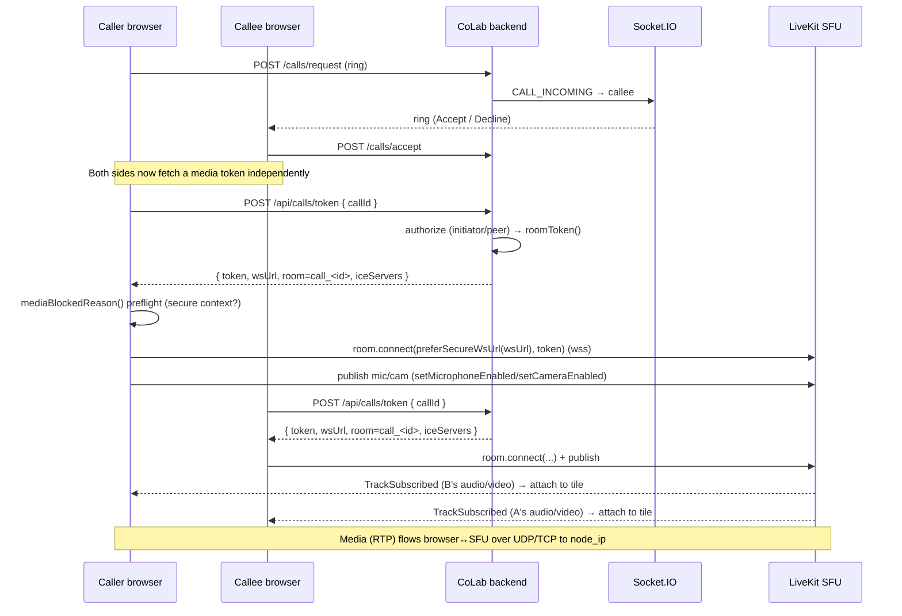
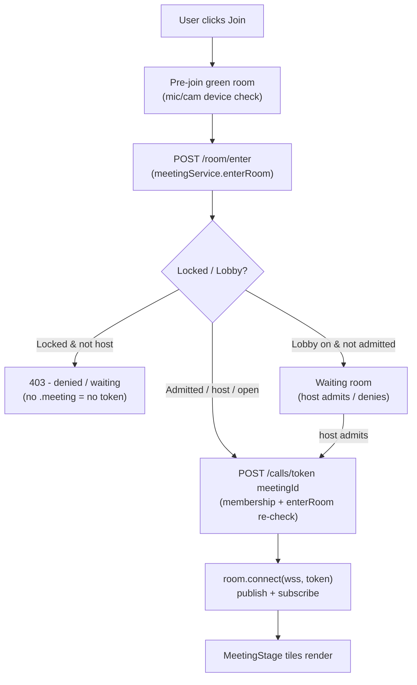
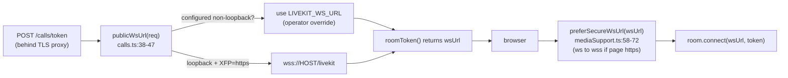
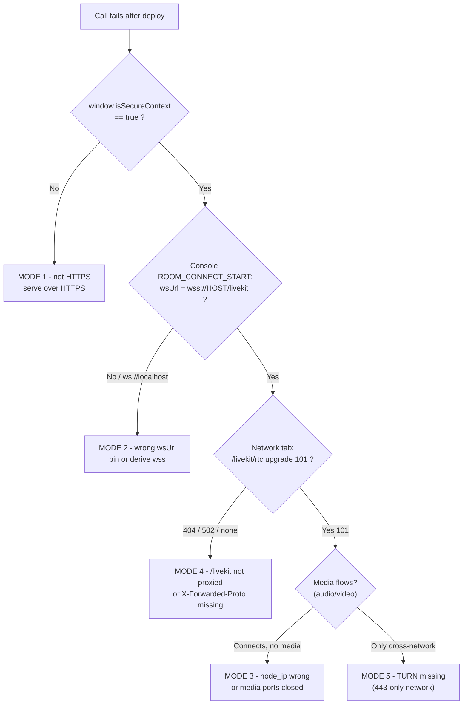

# CoLab Calls & Meetings — LiveKit Architecture, End‑to‑End Flow & Deployment Resolution Guide

> **Purpose of this document**
> A single reference for the meeting on the *post‑deployment call issue*. It explains
> **what LiveKit is in CoLab, how a call/meeting starts, what happens end‑to‑end, what can
> break after deployment, and exactly how to confirm + fix each failure.** Every claim is
> grounded in the actual code/config (`file:line`).
>
> **One‑line summary of the problem class:** *Messaging works but calls fail* is almost always
> a **media‑path / transport** problem (HTTPS, the LiveKit WebSocket URL, the SFU's advertised
> IP, the proxy route, or TURN) — **not** an application‑logic bug. The six modes and their
> fixes are in [§10 Resolution Runbook](#10-resolution-runbook-the-meeting-core).

---

## 1. What LiveKit is and why CoLab uses it

LiveKit is an open‑source **SFU** (Selective Forwarding Unit) — a media server that relays
audio/video between participants. CoLab **self‑hosts** the LiveKit SFU for all 1:1 calls,
group calls (huddles), and scheduled meetings. (One deployment tier instead uses **LiveKit
Cloud** — see [§9](#9-deployment-tiers).)

CoLab's own backend does **two** things around LiveKit and nothing else media‑related:

1. **Mints a short‑lived join token** (a JWT) after authorizing the user — `roomToken()` in
   `backend/app/src/services/livekitService.ts:21‑67`.
2. **Issues server‑side room commands** (mute/remove participants, recording egress) via the
   LiveKit `RoomServiceClient` using the API secret.

The actual **media never touches CoLab's backend** — the browser connects **directly** to the
LiveKit SFU over WebSocket (signalling) + UDP/TCP (media). This is the key mental model: the
backend authorizes and hands out a ticket; the browser walks to the SFU itself.

```
                 ┌──────────────────────── CoLab backend (Express) ───────────────────────┐
   HTTPS /api    │  authMiddleware → /api/calls/token  →  roomToken()  →  JWT + wsUrl +     │
  ───────────────▶  authorize (membership / lobby / lock)                  iceServers       │
   browser       │  RoomServiceClient (mute / remove / egress)  ── API secret ──┐          │
                 └──────────────────────────────────────────────────────────────┼──────────┘
        ▲  ▲                                                                      │
        │  │ token + wsUrl                                                        │ admin cmds
        │  └──────────────────────────────────────────┐                          ▼
   wss  │ signalling (control)                         │              ┌──────────────────────┐
   ─────┼──────────────────────────────────────────────────────────▶ │   LiveKit SFU         │
   UDP/ │ media (RTP) straight to the SFU's node_ip                   │  signalling :7534     │
   TCP  └──────────────────────────────────────────────────────────▶ │  media :7531/7532     │
                                                                      │  built‑in TURN :7533  │
   (TURN relay fallback) ◀───────────────────────────────────────────│  + external coturn    │
                                                                      └──────────────────────┘
```

---

## 2. Components

| Component | Where | Role |
|---|---|---|
| **Browser (LiveKit JS client)** | `frontend/app/src/components/MeetingStage.tsx`, `CoLabV1.tsx` (CallModal) | Connects to the SFU, publishes mic/cam, subscribes to remote tracks, renders tiles |
| **Token minter** | `backend/app/src/services/livekitService.ts` `roomToken()` | Signs the per‑user room JWT (TTL 1h) after the caller authorizes |
| **Token endpoint** | `backend/app/src/routes/calls.ts` `POST /calls/token` | The **only** place real room tokens are issued; runs all auth gates |
| **LiveKit SFU** | `infrastructure/livekit/livekit*.yaml` (Docker `livekit/livekit-server:v1.9`) | Relays media; advertises ICE candidates at `node_ip` |
| **Built‑in TURN** | `livekit.yaml` `turn.enabled: true` udp 7533 | UDP relay fallback, auto‑advertised via signalling |
| **External coturn** (optional) | `infrastructure/coturn/turnserver.conf` | TURN‑over‑TLS relay for off‑LAN / locked‑down networks |
| **Reverse proxy** | `infrastructure/nginx/nginx.conf` (`:7530`) **or** `infrastructure/caddy/Caddyfile` (`:443`) | TLS termination + routes `/livekit` WS → SFU `:7534` |
| **Egress worker** (optional) | `livekit/egress` container | Server‑side recording (see [§8](#8-recording-egress)) |

---

## 3. Port scheme (the 753x range)

The SFU uses a **fixed** port scheme. Media ports are published **directly** to the host;
only signalling goes through the proxy.

| Port | Proto | Purpose | Published? |
|---|---|---|---|
| **7534** | ws/http | LiveKit **signalling** (control channel) | Internal only — proxied as `wss://<host>/livekit` |
| **7531** | TCP | ICE/TCP **media** fallback (when UDP blocked) | Yes, host `7531:7531` |
| **7532** | UDP | ICE/UDP **media** (primary) | Yes, host `7532:7532/udp` |
| **7533** | UDP | LiveKit **built‑in TURN** relay | Yes, host `7533:7533/udp` |
| **7530** | TCP | nginx single user‑facing port (production profile) | Yes (or 443 with Caddy) |

> Source: `infrastructure/livekit/livekit.yaml:6‑27`, `docker-compose.yml:89‑92`.
> **Firewall must open `7531/tcp`, `7532/udp`, `7533/udp`** plus the web port — `docs/DEPLOYMENT.md:104‑107`.

---

## 4. Token minting & authorization

### 4.1 The mint (`roomToken()` — `livekitService.ts:21‑67`)

```
AccessToken(LIVEKIT_API_KEY, LIVEKIT_API_SECRET, {
  identity: userId,                 // == authenticated user's DB id (JWT sub)
  name:     name || userId,         // display name
  ttl:      config.livekit.tokenTtlSec   // default 3600s (1 hour)
}).addGrant({ roomJoin: true, room, canPublish: true, canSubscribe: true, canPublishData: true })
→ returns { token, wsUrl, room, iceServers }
```

- The JWT is **HS256‑signed with the LiveKit API *secret*** (not the app session secret) so the
  SFU can validate it on connect.
- `roomToken()` itself does **no** authorization — *"this function assumes the user is already
  allowed into `room`"* (header comment `livekitService.ts:17‑20`). **All gating happens in the
  caller.**

### 4.2 Room naming convention

| Context | Room name | Source |
|---|---|---|
| 1:1 call | `call_<callId>` | `calls.ts` 1:1 branch |
| Group / conversation call (huddle) | `conv_<conversationId>` | `calls.ts` group branch |
| Scheduled meeting | `meeting_<meetingId>` | `calls.ts` meeting branch |
| Connection‑check probe | `diag_<userId>` (private, no peer can join) | `calls.ts:142‑147` |

### 4.3 Authorization gates (`POST /calls/token` — `calls.ts:96‑137`)

The router is behind `authMiddleware` (`calls.ts:73`). The token is minted **only** after one of
three branches authorizes the user:

- **1:1 call:** the caller must be `call.initiatorId` **or** `call.peerId`, else `403`.
- **Group call:** the caller must be `db.conversations.isMember(conversationId, uid)`, else `403`.
- **Meeting — double gate** (`calls.ts:110‑132`):
  1. **Membership:** host (`createdBy`) or an attendee, else `403`.
  2. **Lock/lobby admission:** `meetingService.enterRoom()` must return `.meeting` (granted).
     If the meeting is **locked** and you're not host/co‑host → `403 "This meeting is locked."`
     If a **lobby** is on and you're not yet admitted → `403 "You haven't been admitted…"`.
     (`meetingService.enterRoom` — `meetingService.ts:159‑189`.)

> **Why this matters:** a crafted client cannot skip the lobby/lock and mint straight into the
> SFU — `enterRoom` returns `.meeting` only when entry is actually granted.

### 4.4 Signalling vs. token (important distinction)

`callService.request/accept/decline` (`callService.ts:13‑72`) drive the **ringing state machine
over Socket.IO** — they set call status, do block checks, atomic busy‑checks. **They do not mint
LiveKit tokens.** The token is fetched separately via `/calls/token`, whose gate is what actually
authorizes SFU entry.

### 4.5 Host controls

Mute / mute‑all / remove go through the LiveKit `RoomServiceClient` using the **API secret**
(`livekitService.ts:8‑105`), gated by `requireConvOwner` (owner/admin only — `calls.ts:149‑175`).
No per‑user JWT is involved for admin commands.

---

## 5. End‑to‑end **call** flow



**Client connect recipe** (identical for calls & meetings — `MeetingStage.tsx:218‑507`,
`CoLabV1.tsx:5812‑6197`):

1. Fetch `{ token, wsUrl, room, iceServers }` from `api.getCallToken` (`api.ts:515`).
2. **Secure‑context preflight** `mediaBlockedReason()` — bail early with guidance if
   `navigator.mediaDevices` is missing (`mediaSupport.ts:16‑49`).
3. Build `new LK.Room({ adaptiveStream, dynacast, publishDefaults{…vp9, simulcast…},
   rtcConfig:{ iceServers } })`. Calls capture **1080p** (`CoLabV1.tsx:5858`), meetings **720p**
   (`MeetingStage.tsx:252`).
4. Register `RoomEvent` handlers (TrackSubscribed→attach, ActiveSpeakers, ConnectionQuality,
   Disconnected/Reconnecting/Reconnected).
5. `await room.connect(preferSecureWsUrl(res.wsUrl), res.token)` — **scheme upgraded to `wss://`
   when the page is HTTPS** (`mediaSupport.ts:58‑72`).
6. Publish local tracks; remote tracks arrive via `TrackSubscribed` → `track.attach()` → tile.

**Reconnection:** exponential backoff `min(300·2^n, 5000)ms`, give up after 5 retries; a 25s
watchdog flips to a retryable failure if media never connects (`CoLabV1.tsx:5797‑5890`).

---

## 6. End‑to‑end **meeting** flow (with lobby / lock)

A meeting adds a **room‑entry gate** before the media token. Two backend calls are involved:

- `POST /api/meetings/:id/room/enter` (`api.enterMeetingRoom`) — admits past lobby/lock, returns
  **presence state only** (no token).
- `POST /api/calls/token { meetingId }` — mints the actual `{ wsUrl, token }` after re‑checking
  membership **and** lobby/lock (`MeetingStage.tsx:230`).



**What Lobby on/off means** (host control — `MeetingRoom.tsx`):
- **Lobby ON** → a **waiting room**. Invited people don't enter directly; they wait and the host
  approves each (admit/deny). Use for interviews, external guests, controlled entry.
- **Lobby OFF** → invited people **join directly**, no approval.
- **Lock** is the harder gate: when locked, *nobody new* (not even invited) can join until unlocked
  — except the host/co‑host and people already inside.

---

## 7. The wsURL + secure‑context chain — **the part that bites on deployment**

This is the crux of the "calls fail after deployment" problem. Two browser rules are absolute and
**cannot be bypassed by any code**:

1. **`getUserMedia` (mic/cam) only exists in a *secure context*** — HTTPS, or `http://localhost` /
   `http://127.0.0.1`. On a plain‑HTTP LAN IP (e.g. `http://10.205.11.8:3002`)
   `navigator.mediaDevices` is **undefined** → calls die instantly while messaging keeps working.
2. **An HTTPS page may not open a `ws://` socket** (mixed content) — so the LiveKit URL must be
   `wss://` whenever the page is HTTPS.

CoLab handles both **on the server** (derive the right URL) and **on the client** (fail fast +
upgrade scheme):



- **`publicWsUrl()` (`calls.ts:38‑47`):** if `LIVEKIT_WS_URL` is loopback/blank **and** the request
  arrives with `X‑Forwarded‑Proto: https` + Host, it returns **`wss://<the host the browser used>/livekit`** —
  correct for a bare IP, LAN host, public domain, or tunnel **with no env change**. An explicit
  **non‑loopback** `LIVEKIT_WS_URL` always wins (pin it for determinism behind a corporate LB).
- **Boot guard (`index.ts:51‑65`):** in production the backend **refuses to start** if
  `LIVEKIT_WS_URL` is `localhost`/`127.0.0.1` (prevents silently shipping a broken URL).
- **`mediaBlockedReason()` (`mediaSupport.ts:16‑49`):** the client checks the secure context and
  `navigator.mediaDevices` **before** connecting and aborts with an actionable message instead of a
  crash. Wired into both `CoLabV1.tsx:5839` and `MeetingStage.tsx:236`.
- **`LIVEKIT_WS_URL` (browser‑facing) vs `LIVEKIT_SERVER_URL` (internal):** the join token carries
  `LIVEKIT_WS_URL` for the browser; the backend's own `RoomServiceClient` talks to
  `LIVEKIT_SERVER_URL` (`ws://livekit:7534` on the compose network — `livekitHost()`
  `livekitService.ts:4‑15`). Don't confuse them.

---

## 8. ICE / NAT traversal / `node_ip` / TURN

When the browser connects, the SFU advertises **ICE candidates** — the addresses the browser
should send media to. **The single most important media setting is `rtc.node_ip`** — the IP the
SFU puts in those candidates.

- **Internal corporate server (private 10.x):** **pin** `node_ip` to the exact IP clients reach
  and set `use_external_ip: false`. If `use_external_ip: true` is left on for an internal box, STUN
  detects an internet‑facing/wrong IP and advertises an **unreachable** candidate → *connects but
  no media*.
- **Public cloud VM (routable public IP):** keep `use_external_ip: true` (auto‑detect) — that's
  `livekit.prod.yaml`.
- **Built‑in TURN** (`turn.enabled: true`, UDP 7533) is auto‑advertised as a relay fallback when a
  direct path fails.
- **External coturn / TURN‑over‑TLS:** for networks that allow only **443 outbound**, UDP TURN
  can't help — you need `turns://…:443`. The backend advertises external TURN to the browser via
  `roomToken().iceServers` **only when `TURN_URLS` is set** (`livekitService.ts:45‑66`,
  `config/src/index.ts:54‑57`). Empty `TURN_URLS` → LAN‑only.

> **Known inconsistency to flag in the meeting:** `coturn/turnserver.conf` is written for
> **ephemeral HMAC** creds (`use-auth-secret`), but the backend advertises **static**
> `TURN_USERNAME`/`TURN_PASSWORD` — there is **no HMAC minting code**. If external coturn is used,
> run it in **long‑term‑credential** mode (matching the static user/pass) **or** add ephemeral
> minting. Also: `external-ip`/`relay-ip` and `static-auth-secret` in `turnserver.conf` ship as
> placeholders and **must** be set at deploy.

---

## 9. Deployment tiers

| Tier | Public host | SFU `node_ip` | `use_external_ip` | LiveKit config | Web port | `LIVEKIT_WS_URL` |
|---|---|---|---|---|---|---|
| **Local** | localhost | `127.0.0.1` | false | `livekit.yaml` | 3002 | `ws://localhost:7534` (dev) |
| **Test / teams** | `collab.resul.team` | `10.205.11.8` | false | `livekit.test.yaml` | 7520 | `wss://collab.resul.team/livekit` |
| **Live** | `collab.resulticks.com` | `10.200.3.17` | false | `livekit.live.yaml` | 3002 | `wss://collab.resulticks.com/livekit` |
| **Generic public** | (your domain) | *(auto STUN)* | **true** | `livekit.prod.yaml` | 443 (Caddy) | blank → auto‑derive |
| **Cloud / Tunnel** | Cloudflare URL | *(LiveKit Cloud)* | n/a | none (Cloud) | tunnel | `wss://…livekit.cloud` |

> Both corporate tiers are **inside the company network** (private 10.x), reached over LAN/VPN,
> so `use_external_ip` is deliberately **false** and `node_ip` is pinned (`livekit.test.yaml:10‑22`,
> `livekit.live.yaml:10‑22`). *The only line that differs between test and live is `node_ip`.*
> Ports in `.env.live`/`.env.teams` (3002 / 7520) differ from the older `DEPLOY_RUNBOOK.md` table
> (7524 / 3002) — **trust `.env`**.

**Reverse proxy — the `/livekit` route is mandatory and must strip the prefix:**
the browser connects to `wss://<host>/livekit`; the LiveKit JS client appends `/rtc/v1`; the proxy
**strips `/livekit`** (LiveKit serves at `/rtc`, not `/livekit/rtc`) and forwards to `livekit:7534`
with **WebSocket upgrade** + **`X‑Forwarded‑Proto: https`** + **Host**.
- nginx: `location /livekit { rewrite ^/livekit/?(.*)$ /$1 break; proxy_pass http://livekit_signal; …Upgrade… }` (`nginx.conf:43‑62`).
- Caddy: `handle_path /livekit* { reverse_proxy livekit:7534 }` (`Caddyfile:49‑51`).
Media ports (7531/7532/7533) are **not** proxied — they're published direct to the host.

---

## 10. Resolution runbook (THE MEETING CORE)

> **Golden rule for triage:** *messaging works but calls don't* ⇒ media path, not app logic.
> Walk these in order. The fastest first step is **§10.7 ConnectionCheck**.



### Mode 1 — Plain‑HTTP bare IP (insecure context hides mic/cam) — *the classic*
- **Symptom:** messaging works; **every** call/meeting instantly fails *"Unable to connect to media
  server"*; the mic/camera prompt never appears; works on `localhost` but not the LAN IP.
- **Confirm:** F12 → `window.isSecureContext === false`; in‑app **Connection Check → "Secure
  context (HTTPS)" row FAILS**; console shows `[call] MEDIA_UNAVAILABLE … reason=Calls and meetings
  need a secure connection…`.
- **Fix:** serve the **whole app over HTTPS** (Caddy `tls internal` self‑signed, or Let's Encrypt;
  or terminate TLS at the corporate LB). `mediaSupport.ts:4‑49`, `docs/DEPLOYMENT.md:12‑18`.

### Mode 2 — `wsUrl = ws://localhost` handed to remote browsers
- **Symptom:** call spins on *"connecting media…"* then fails; no `wss` connection appears; or an
  HTTPS page silently blocks the `ws://` socket (mixed content).
- **Confirm:** F12 console `[call] ROOM_CONNECT_START … wsUrl=…` (`CoLabV1.tsx:6175`) shows
  `ws://localhost`; the backend may also be **crash‑looping** with `[boot] FATAL: LIVEKIT_WS_URL
  must point to the public server…` (`index.ts:51‑65`).
- **Fix:** either **pin** `LIVEKIT_WS_URL=wss://<host>/livekit`, **or** leave it blank/loopback and
  let `publicWsUrl()` derive it — which requires the proxy to forward `X‑Forwarded‑Proto: https`
  (see Mode 4). Client safety net `preferSecureWsUrl()` upgrades `ws→wss` on HTTPS pages.

### Mode 3 — LiveKit `node_ip` not routable / wrong IP
- **Symptom:** the call **connects** (signalling OK) but stays *"connecting media…"* with no
  audio/video — **especially cross‑network**.
- **Confirm:** signalling/`ROOM_CONNECT` succeeds but media never flows; inspect **ICE
  candidate‑pair stats → no *succeeded* pair**; `DEPLOY_RUNBOOK.md:150`.
- **Fix:** set `LIVEKIT_CONFIG_FILE` to the yaml whose `node_ip` is the IP clients actually reach
  (`livekit.test.yaml` → 10.205.11.8, `livekit.live.yaml` → 10.200.3.17); `use_external_ip:false`
  for internal boxes, `true` only for public‑IP hosts. Confirm media ports 7531/7532/7533 are open.

### Mode 4 — `/livekit` WS route not proxied, or `X‑Forwarded‑Proto`/Host not forwarded
- **Symptom:** **no** `wss://…/livekit` connection at all; the call never starts media.
- **Confirm:** Network tab shows **no `/livekit/rtc` upgrade**, or a **404/502**;
  `DEPLOY_RUNBOOK.md:149`.
- **Fix:** the user‑facing port (or corporate LB) must (a) route `/livekit*` → LiveKit `:7534` with
  **WS upgrade ON** and **strip the `/livekit` prefix**, and (b) forward `X‑Forwarded‑Proto: https`
  + Host. Reference configs: `nginx.conf:43‑62`, `Caddyfile:49‑51`. **When behind a corporate LB
  (live), the LB is the most likely thing misconfigured** — pin `LIVEKIT_WS_URL` to sidestep the
  header dependence.

### Mode 5 — No TURN / TURN unreachable on strict or cross‑network paths
- **Symptom:** works **same‑LAN** but **cross‑network** (different office, home, mobile data, VPN)
  media never connects.
- **Confirm:** Connection Check → **"Media server" row fails** with *"…usually a firewall/TURN
  issue. Try another network or check TURN (TURNS:443)."*
- **Fix:** open `7531/tcp`, `7532/udp`, `7533/udp` on the firewall; for **443‑only** networks add a
  **`turns://…:443`** relay (`TURN_URLS`/`TURN_USERNAME`/`TURN_PASSWORD`, or run coturn with
  `tls-listening-port 5349` / `alt-tls-listening-port 443`). This is a standard WebRTC constraint —
  no app change. `livekitService.ts:45‑66`, `turnserver.conf`.

### Mode 6 / §10.7 — Built‑in diagnostic: **Connection Check**
`ConnectionCheck.tsx:49‑144` is a one‑click pre‑flight that walks the **exact** call path and
pinpoints the failing mode:
1. WebRTC capability, 2. **Secure context** (Mode 1), 3. backend reachable + mints a `diag_<uid>`
probe token, 4‑5. mic/cam permission, 6. a **real LiveKit connect** to the private probe room
(18s timeout) and inspects candidate‑pair stats to report **"Connected via TURN relay"** vs direct
(Modes 3/4/5). It uses the **same derived wsUrl** real calls use.
> **Do this first after every deploy, and from a phone on mobile data** (a different network) —
> every row must pass, especially **Secure context** and **Media server** (`docs/DEPLOYMENT.md:158‑163`).

---

## 11. Recording (Egress) — related, often confused with call failures

Recording is **separate** from the call media path:
- **Server‑side egress** needs a dedicated `livekit/egress` worker + Redis + S3/MinIO. It's
  **OFF by default** (`EGRESS_ENABLED`); without it the backend returns an honest `503`
  (`recordingService.ts`). On localhost it also can't work because egress can't reach media at
  `node_ip 127.0.0.1`.
- **CoLab also ships client‑side recording** (browser `MediaRecorder` composites the tiles + mixes
  audio, uploads to MinIO; falls back to a device download if storage is down) — this works without
  egress. Recordings appear in the in‑room **"Recordings (N)"** panel.
- The egress completion webhook is `POST /api/livekit/webhook` (`routes/livekit.ts:12‑45`) — **not**
  a token endpoint.

---

## 12. Quick deploy checklist (per server)

1. App reachable over **HTTPS** (TLS at proxy/LB). *(Mode 1)*
2. Proxy routes **`/livekit*` → `:7534`** (WS upgrade, prefix stripped) and forwards
   **`X‑Forwarded‑Proto: https` + Host**. *(Mode 4)*
3. `LIVEKIT_WS_URL` = `wss://<host>/livekit` (pinned) **or** blank to auto‑derive. Backend boots
   (no FATAL). *(Mode 2)*
4. `LIVEKIT_CONFIG_FILE` = the yaml whose **`node_ip`** matches the IP clients reach;
   `use_external_ip:false` internal / `true` public. *(Mode 3)*
5. Firewall: web port + **`7531/tcp`, `7532/udp`, `7533/udp`**. *(Mode 5)*
6. (Cross‑network / 443‑only clients) configure **`turns://…:443`** TURN. *(Mode 5)*
7. `LIVEKIT_API_KEY`/`LIVEKIT_API_SECRET` are **real** (not `devkey`/default) and match
   `LIVEKIT_KEYS` in the SFU.
8. Run **Connection Check from another network** — all rows green. *(Mode 6)*

---

### Appendix — key file map

| Concern | File |
|---|---|
| Token mint + ICE servers + admin | `backend/app/src/services/livekitService.ts` |
| Token endpoint + auth gates + `publicWsUrl` | `backend/app/src/routes/calls.ts` |
| Meeting lobby/lock entry gate | `backend/app/src/services/meetingService.ts` |
| Production boot guard | `backend/app/src/index.ts` |
| Egress webhook receiver | `backend/app/src/routes/livekit.ts` |
| Secure‑context + ws→wss preflight | `frontend/app/src/lib/mediaSupport.ts` |
| Connection diagnostic | `frontend/app/src/components/ConnectionCheck.tsx` |
| Meeting client connect | `frontend/app/src/components/MeetingStage.tsx` |
| Call client connect | `frontend/app/src/components/CoLabV1.tsx` (CallModal) |
| LiveKit config (per tier) | `infrastructure/livekit/livekit{,.test,.live,.prod}.yaml` |
| External TURN | `infrastructure/coturn/turnserver.conf` + `config/src/index.ts` `turn` |
| Reverse proxy | `infrastructure/nginx/nginx.conf`, `infrastructure/caddy/Caddyfile` |
| Compose (ports/env per tier) | `docker-compose{,.live,.production,.cloud}.yml` |
